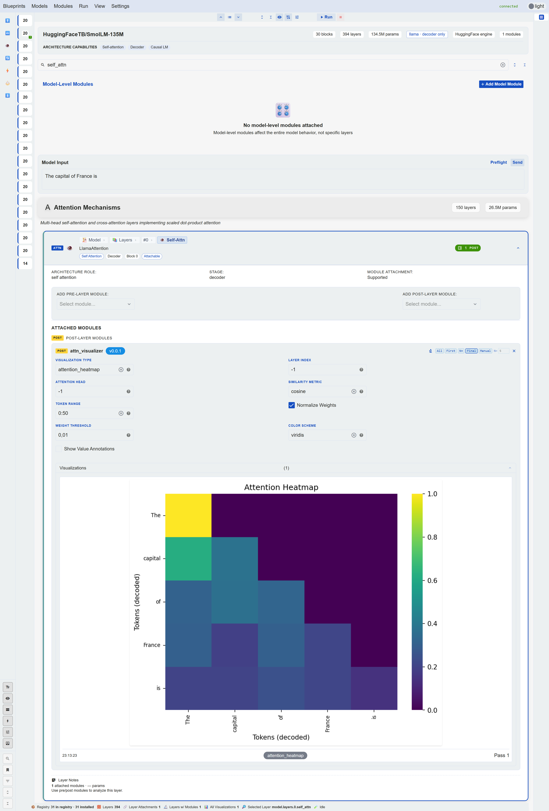

# Looks To The Sun
> An experimental playground for inspecting transformer models.

## Status

LTTS is a research preview for local interpretability experiments. APIs and
module contracts may change.

## About

Looks To The Sun inspects transformer models during inference. It maps model
structure, finds compatible module attachment points, and streams diagnostics
to the UI.

## Modules

Analysis modules live in
**[LTTS-modules](https://github.com/seruva19/LTTS-modules)**. LTTS loads them
from a sibling checkout by default; set `LTTS_MODULES_DIR` to use another path.
The module repository README lists the available modules.

Registry installation is disabled by default because modules execute Python in
the server process. Set `LTTS_ALLOW_MODULE_INSTALL=1` to enable it. Installed
modules are written to `ltts_modules/`, not the source checkout.

## Models

The model list includes one checkpoint per supported topology. To add another,
enter its Hugging Face model id. LTTS reads the model configuration, infers the
task, and stores the entry in the ignored `user/models.user.yaml` file.

Entries can also be written by hand to set an explicit `task`, `revision`,
`subfolder`, `trust_remote_code`, or model-loading overrides.

## Architecture and task support

The loader uses Hugging Face `AutoConfig` plus a task-specific model class.
Architecture support is capability-based: modules declare whether they need
blocks, self/cross-attention, gradients, a tokenizer, or an unembedding, and
the backend rejects incompatible attachments before inference.

| topology | recognized families | inference tasks | validation |
|---|---|---|---|
| decoder-only | Llama, Mistral/Mixtral, GPT-2/Neo/NeoX, OPT, Bloom, Falcon, Gemma, Qwen2, Phi, MPT, OLMo and related configs | causal LM, base model | GPT-2 and SmolLM end-to-end |
| encoder-only | BERT, RoBERTa, DeBERTa, DistilBERT, Electra, ALBERT, Longformer, MPNet and related configs | masked LM, sequence/token classification, QA, base model | BERT masked LM end-to-end |
| encoder-decoder | T5/mT5, BART/mBART, Marian, Pegasus, LongT5, Switch Transformer and related configs | seq2seq LM, base model | T5 seq2seq and cross-attention end-to-end |
| multimodal | LLaVA, Idefics, BLIP, PaliGemma, Qwen2-VL, MLLama and related configs | structural discovery only | no processor or media-input pipeline |

“Recognized” means the adapter can classify the topology and semantic module
roles. A concrete checkpoint can still require custom code, remote-code trust,
or a processor not supplied by LTTS. The model registry supports explicit task,
revision, subfolder, `trust_remote_code`, and model-loading overrides.

## Research-use boundaries

LTTS reports measurements, not ground-truth explanations. Validate findings
with controls, multiple prompts or seeds, and independent methods.

- Gradient saliency and gradient×activation use the gradient of an explicit
  output target selected from token, class, QA-span, or base-model output.
- Occlusion methods run bounded perturbation forwards and report their baseline
  and scoring definition.
- Logit-space modules require a real output embedding and are hidden/rejected
  where that operation is undefined.
- Attention modules require obtainable attention weights; LTTS switches to an
  eager attention implementation only for runs that need them.
- SAE inspection requires `sae_lens` plus an SAE release whose input dimension
  matches the selected model. Control vectors require `repeng` and currently
  target supported decoder-only stacks.
- The UI and API expose module target roles, supported topologies, capabilities,
  optional dependencies, resolved paths, and per-run diagnostics. A module that
  does not emit is not silently treated as successful.

## Roadmap

`[x]` marks an available [module](docs/MODULE_AUTHORING.md); `[ ]` marks planned
work. Paper and code links describe the underlying technique.

### Attention analysis
- [x] Attention pattern visualization — [paper](https://arxiv.org/abs/1906.05714), [code](https://github.com/jessevig/bertviz)
- [x] Attention rollout / attention flow — [paper](https://arxiv.org/abs/2005.00928)
- [x] Attention-entropy metrics (mutual-information planned)
- [x] Per-head attention grid (every head of a layer at once)
- [ ] Value-weighted / norm-based attention (Kobayashi et al.) — [paper](https://arxiv.org/abs/2004.10102), [code](https://github.com/gorokoba560/norm-analysis-of-transformer)
- [ ] Attention knockout / head ablation (Geva et al.) — [paper](https://arxiv.org/abs/2304.14767), [code](https://github.com/google-research/google-research/tree/master/dissecting_factual_predictions)
- [ ] Attention-head importance scoring & pruning (Voita et al.; Michel et al.) — [paper](https://arxiv.org/abs/1905.09418), [code](https://github.com/lena-voita/the-story-of-heads)
- [ ] QK / OV circuit analysis (Elhage et al.) — [paper](https://transformer-circuits.pub/2021/framework/index.html)
- [ ] Functional head taxonomy (previous-token, duplicate-token, name-mover, …) — [paper](https://arxiv.org/abs/2211.00593), [code](https://github.com/redwoodresearch/Easy-Transformer)
- [ ] Attention superposition analysis — [paper](https://transformer-circuits.pub/2023/may-update/index.html)
- [ ] Attention-as-explanation debate (Jain & Wallace; Wiegreffe & Pinter) — [paper](https://arxiv.org/abs/1902.10186), [rebuttal](https://arxiv.org/abs/1908.04626)
- [ ] Value Zeroing (context-mixing rather than raw attention) — [paper](https://arxiv.org/abs/2301.12971), [code](https://github.com/hmohebbi/ValueZeroing)
- [ ] Self-attention attribution (AttAttr — attributing attention *edges*) — [paper](https://arxiv.org/abs/2004.11207), [code](https://github.com/YRdddream/attattr)
- [ ] Attention-sink profiling & sink ablation — [StreamingLLM](https://arxiv.org/abs/2309.17453), [why the first token](https://arxiv.org/abs/2504.02732), [code](https://github.com/mit-han-lab/streaming-llm)

### Feature attribution & saliency
- [x] Token saliency mapping (gradient-based) — [paper](https://arxiv.org/abs/1312.6034)
- [x] Gradient × Input saliency — [paper](https://arxiv.org/abs/1605.01713), [code](https://github.com/pytorch/captum)
- [x] Integrated Gradients (IG) — [paper](https://arxiv.org/abs/1703.01365), [code](https://github.com/pytorch/captum)
- [x] Occlusion / masked-perturbation attribution — [paper](https://arxiv.org/abs/1311.2901), [code](https://github.com/pytorch/captum)
- [x] Per-token contribution analysis by full-forward token occlusion
- [x] SmoothGrad / activation-space NoiseGrad / VarGrad — [paper](https://arxiv.org/abs/1706.03825), [code](https://github.com/PAIR-code/saliency)
- [ ] Guided backpropagation / DeconvNet — [paper](https://arxiv.org/abs/1412.6806), [code](https://github.com/pytorch/captum)
- [ ] DeepLIFT / DeepSHAP — [paper](https://arxiv.org/abs/1704.02685), [code](https://github.com/pytorch/captum)
- [ ] SHAP (Kernel / Partition / Sampling Shapley) — [paper](https://arxiv.org/abs/1705.07874), [code](https://github.com/shap/shap)
- [ ] LIME (local surrogate explanations) — [paper](https://arxiv.org/abs/1602.04938), [code](https://github.com/marcotcr/lime)
- [ ] Feature ablation / feature permutation — [code](https://github.com/pytorch/captum)
- [ ] Layer-wise Relevance Propagation (LRP) — [paper](https://doi.org/10.1371/journal.pone.0130140), [code](https://github.com/chr5tphr/zennit)
- [ ] Transformer-specific relevance rollout (Chefer et al.) — [paper](https://arxiv.org/abs/2012.09838), [code](https://github.com/hila-chefer/Transformer-Explainability)
- [ ] Attention-aware LRP (AttnLRP) — [paper](https://arxiv.org/abs/2402.05602), [code](https://github.com/rachtibat/LRP-eXplains-Transformers)
- [ ] Contextual decomposition — [paper](https://arxiv.org/abs/1801.05453), [code](https://github.com/jamie-murdoch/ContextualDecomposition)
- [ ] Contrastive / counterfactual explanations — [paper](https://arxiv.org/abs/2202.10419)
- [ ] Attribution fusion / ensemble explainability — [paper](https://arxiv.org/abs/1903.00519)
- [x] Activation-space attribution controls and sanity diagnostics (not parameter randomization) — [paper](https://arxiv.org/abs/1810.03292), [code](https://github.com/adebayoj/sanity_checks_saliency)
- [ ] Sequence-attribution toolkit (Inseq) — [paper](https://arxiv.org/abs/2302.13942), [code](https://github.com/inseq-team/inseq)
- [ ] Model-parameter randomization sanity checks (cascading / independent) — [paper](https://arxiv.org/abs/1810.03292), [code](https://github.com/adebayoj/sanity_checks_saliency)
- [ ] Context attribution via ablation surrogates (ContextCite) — [paper](https://arxiv.org/abs/2409.00729), [code](https://github.com/MadryLab/context-cite)
- [ ] RAG context-sensitivity & internals-based answer attribution (MIRAGE) — [paper](https://arxiv.org/abs/2406.13663), [code](https://github.com/Betswish/MIRAGE)

### Logit-space & residual-stream analysis
- [x] Logit lens / residual-stream decomposition — [paper](https://www.lesswrong.com/posts/AcKRB8wDpdaN6v6ru/interpreting-gpt-the-logit-lens)
- [x] Direct Logit Attribution (DLA) — [code](https://github.com/TransformerLensOrg/TransformerLens)
- [x] Logit-lens grid (top-1 token per layer × position)
- [x] Next-token distribution (entropy + top-k table + bar chart)
- [ ] Tuned Lens (learned per-layer affine probes) — [paper](https://arxiv.org/abs/2303.08112), [code](https://github.com/AlignmentResearch/tuned-lens)
- [ ] Future Lens (decode later tokens from one state) — [paper](https://arxiv.org/abs/2311.04897), [code](https://github.com/KoyenaPal/future-lens)
- [x] Logit difference / contrastive logit analysis
- [x] Residual-stream norm tracking — [paper](https://transformer-circuits.pub/2021/framework/index.html)
- [ ] DLA decomposed by head and by MLP neuron — [paper](https://transformer-circuits.pub/2021/framework/index.html), [code](https://github.com/TransformerLensOrg/TransformerLens)
- [ ] Backward Lens (projecting *gradients* into vocabulary space) — [paper](https://arxiv.org/abs/2402.12865), [code](https://github.com/shacharKZ/BackwardLens)

### Probing & representation geometry
- [ ] Linear probing of hidden states (Alain & Bengio) — [paper](https://arxiv.org/abs/1610.01644)
- [ ] Probe selectivity & control tasks (Hewitt & Liang) — [paper](https://arxiv.org/abs/1909.03368), [code](https://github.com/john-hewitt/control-tasks)
- [ ] MDL / information-theoretic probing (Voita & Titov) — [paper](https://arxiv.org/abs/2003.12298), [code](https://github.com/lena-voita/description-length-probing)
- [ ] Structural probes / syntax trees (Hewitt & Manning) — [paper](https://aclanthology.org/N19-1419/), [code](https://github.com/john-hewitt/structural-probes)
- [ ] Amnesic probing / causal probing (Elazar et al.) — [paper](https://arxiv.org/abs/2006.00995), [code](https://github.com/yanaiela/amnesic_probing)
- [ ] Contrast-Consistent Search (CCS) / discovering latent knowledge (Burns et al.) — [paper](https://arxiv.org/abs/2212.03827), [code](https://github.com/collin-burns/discovering_latent_knowledge)
- [ ] Truthfulness / deception probes ("Geometry of Truth") — [paper](https://arxiv.org/abs/2310.06824), [code](https://github.com/saprmarks/geometry-of-truth)
- [ ] Calibration & confidence probing — [paper](https://arxiv.org/abs/2207.05221)
- [x] CKA representation similarity (SVCCA planned) — [paper](https://arxiv.org/abs/1905.00414), [code](https://github.com/google-research/google-research/tree/master/representation_similarity)
- [ ] SVCCA / PWCCA representation comparison — [paper](https://arxiv.org/abs/1706.05806), [code](https://github.com/google/svcca)
- [ ] Cross-model & cross-checkpoint representation alignment (Platonic) — [paper](https://arxiv.org/abs/2405.07987), [code](https://github.com/minyoungg/platonic-rep)
- [x] Embedding-space visualization (PCA, t-SNE; UMAP planned) — [paper](https://arxiv.org/abs/1802.03426), [code](https://github.com/lmcinnes/umap)
- [ ] Anisotropy / isotropy analysis of embeddings (Ethayarajh) — [paper](https://arxiv.org/abs/1909.00512)
- [ ] Intrinsic dimensionality & participation ratio (Ansuini et al.) — [paper](https://arxiv.org/abs/1905.12784), [code](https://github.com/ansuini/IntrinsicDimDeep)
- [ ] Linear-representation-hypothesis tests (Park et al.) — [paper](https://arxiv.org/abs/2311.03658), [code](https://github.com/KihoPark/linear_rep_geometry)
- [ ] Sparse probing (k-sparse probes for neuron-level feature localization) — [paper](https://arxiv.org/abs/2305.01610), [code](https://github.com/wesg52/sparse-probing-paper)
- [ ] SAE latents vs. raw-activation probe baselines across data regimes — [paper](https://arxiv.org/abs/2502.16681), [code](https://github.com/JoshEngels/SAE-Probes)
- [ ] Irreducible multi-dimensional features (circular day/month representations) — [paper](https://arxiv.org/abs/2405.14860), [code](https://github.com/JoshEngels/MultiDimensionalFeatures)

### Neuron & layer analysis
- [x] Layer and neuron activation inspection
- [x] Layer activation statistics (norms / sparsity / distributions)
- [x] Per-neuron activation tracking
- [x] Model architecture introspection
- [x] Neuron ablation / functional knockout
- [x] Token × neuron activation map (per-token activations of top-variance neurons)
- [ ] Maximally-activating dataset exemplars per neuron — [paper](https://arxiv.org/abs/1506.06579)
- [ ] Knowledge neurons (Dai et al.) — [paper](https://arxiv.org/abs/2104.08696), [code](https://github.com/Hunter-DDM/knowledge-neurons)
- [ ] Universal / cross-model neuron identification (Gurnee et al.) — [paper](https://arxiv.org/abs/2401.12181), [code](https://github.com/wesg52/universal-neurons)
- [ ] Polysemanticity & monosemanticity quantification — [paper](https://transformer-circuits.pub/2023/monosemantic-features/index.html)
- [ ] Neuron superposition & feature-collision analysis — [paper](https://transformer-circuits.pub/2022/toy_model/index.html)
- [ ] Automated neuron interpretation / captioning (Bills et al.) — [paper](https://openai.com/index/language-models-can-explain-neurons-in-language-models/), [code](https://github.com/openai/automated-interpretability)
- [ ] Neuron activation steering / clamping — [paper](https://arxiv.org/abs/2308.10248)
- [ ] Massive activations, outlier dimensions & super weights — [massive activations](https://arxiv.org/abs/2402.17762), [super weight](https://arxiv.org/abs/2411.07191), [code](https://github.com/locuslab/massive-activations)
- [ ] Layer-redundancy map (Block Influence, layer-skip validation) — [paper](https://arxiv.org/abs/2403.03853), [code](https://github.com/arcee-ai/PruneMe)

### Sparse dictionary learning (SAEs & beyond)
- [x] Sparse feature discovery (pretrained SAEs via SAELens; training planned) — [code](https://github.com/jbloomAus/SAELens)
- [ ] SAE training — ReLU SAEs (Cunningham et al.; Bricken et al.) — [paper](https://arxiv.org/abs/2309.08600), [Anthropic](https://transformer-circuits.pub/2023/monosemantic-features/index.html), [code](https://github.com/HoagyC/sparse_coding)
- [ ] Gated SAEs — [paper](https://arxiv.org/abs/2404.16014)
- [ ] JumpReLU SAEs — [paper](https://arxiv.org/abs/2407.14435)
- [ ] TopK / BatchTopK SAEs — [TopK](https://arxiv.org/abs/2406.04093), [BatchTopK](https://arxiv.org/abs/2412.06410), [code](https://github.com/bartbussmann/BatchTopK)
- [ ] Matryoshka SAEs — [paper](https://arxiv.org/abs/2503.17547)
- [ ] End-to-end SAEs — [paper](https://arxiv.org/abs/2405.12241), [code](https://github.com/ApolloResearch/e2e_sae)
- [ ] Transcoders / skip-transcoders — [transcoders](https://arxiv.org/abs/2406.11944), [skip](https://arxiv.org/abs/2501.18823), [code](https://github.com/jacobdunefsky/transcoder_circuits)
- [ ] Crosscoders (cross-layer & model-diffing) — [paper](https://transformer-circuits.pub/2024/crosscoders/index.html)
- [ ] Automated SAE-feature scoring (detection / fuzzing) — [paper](https://arxiv.org/abs/2410.13928), [code](https://github.com/EleutherAI/delphi)
- [ ] Feature splitting / absorption / completeness analysis — [paper](https://arxiv.org/abs/2409.14507)
- [ ] SAE-feature steering & clamping — [paper](https://transformer-circuits.pub/2024/scaling-monosemanticity/index.html)
- [ ] Dictionary-learning stability & feature-merging tests — [paper](https://arxiv.org/abs/2501.16615)
- [ ] Output-centric feature descriptions (VocabProj / TokenChange) — [paper](https://arxiv.org/abs/2501.08319), [code](https://github.com/yoavgur/Feature-Descriptions)
- [ ] SAE evaluation suite (loss recovered, sparse probing, SCR/TPP — SAEBench) — [paper](https://arxiv.org/abs/2503.09532), [code](https://github.com/adamkarvonen/SAEBench)
- [ ] Entity knowledge-awareness directions (known vs. unknown entities) — [paper](https://arxiv.org/abs/2411.14257)

### Causal interventions & mechanistic analysis
- [x] Activation patching (causal interventions) — [paper](https://arxiv.org/abs/2004.12265)
- [ ] Attribution patching (gradient-efficient) — [blog](https://www.neelnanda.io/mechanistic-interpretability/attribution-patching), [AtP*](https://arxiv.org/abs/2403.00745)
- [ ] Path patching — [paper](https://arxiv.org/abs/2304.05969)
- [ ] Causal tracing / mediation analysis (ROME) — [paper](https://arxiv.org/abs/2202.05262), [code](https://github.com/kmeng01/rome)
- [ ] Causal scrubbing — [paper](https://www.alignmentforum.org/s/h95ayYYwMebGEYN5y/p/JvZhhzycHu2Yd57RN)
- [ ] Causal abstraction / Distributed Alignment Search (DAS) — [paper](https://arxiv.org/abs/2303.02536), [code](https://github.com/stanfordnlp/pyvene)
- [ ] Interchange-intervention training (IIT) — [paper](https://arxiv.org/abs/2112.00826)
- [ ] Resample / mean / zero ablation comparisons — [paper](https://arxiv.org/abs/2309.16042)
- [ ] Self-repair / Hydra-effect measurement (downstream compensation after ablation) — [paper](https://arxiv.org/abs/2307.15771), [follow-up](https://arxiv.org/abs/2402.15390)

### Circuit discovery
- [x] Induction-head detection — [paper](https://transformer-circuits.pub/2022/in-context-learning-and-induction-heads/index.html)
- [ ] Head composition analysis (Q/K/V composition circuits) — [paper](https://transformer-circuits.pub/2021/framework/index.html)
- [ ] Automatic Circuit DisCovery (ACDC) — [paper](https://arxiv.org/abs/2304.14997), [code](https://github.com/ArthurConmy/Automatic-Circuit-Discovery)
- [ ] Edge Attribution Patching (EAP / EAP-IG) — [EAP](https://arxiv.org/abs/2310.10348), [EAP-IG](https://arxiv.org/abs/2403.17806)
- [ ] Subnetwork probing / circuit-via-pruning — [paper](https://arxiv.org/abs/2104.03514), [code](https://github.com/stevenxcao/subnetwork-probing)
- [ ] Sparse feature circuits (Marks et al.) — [paper](https://arxiv.org/abs/2403.19647), [code](https://github.com/saprmarks/feature-circuits)
- [ ] Attribution graph construction — [paper](https://transformer-circuits.pub/2025/attribution-graphs/methods.html)
- [ ] Circuit tracing / replacement-model analysis ("biology of LLMs") — [paper](https://transformer-circuits.pub/2025/attribution-graphs/biology.html)
- [ ] Information-flow routes / functional component graphs — [paper](https://arxiv.org/abs/2403.00824), [code](https://github.com/facebookresearch/llm-transparency-tool)
- [ ] Circuit faithfulness & minimality evaluation — [paper](https://arxiv.org/abs/2211.00593)

### Weight-space analysis
- [ ] Effective-weight / folded-weight analysis — [paper](https://transformer-circuits.pub/2021/framework/index.html)
- [ ] Weight SVD / singular-vector interpretation — [paper](https://www.lesswrong.com/posts/mkbGjzxD8d8XqKHzA/the-singular-value-decompositions-of-transformer-weight)
- [ ] OV & QK weight-circuit eigenanalysis — [paper](https://transformer-circuits.pub/2021/framework/index.html)
- [ ] Embedding & unembedding geometry (tied weights) — [paper](https://arxiv.org/abs/1608.05859), [code](https://github.com/ofirpress/UsingTheOutputEmbedding)
- [ ] Toy models of superposition — [paper](https://transformer-circuits.pub/2022/toy_model/index.html), [code](https://github.com/anthropics/toy-models-of-superposition)
- [ ] Linear parameter decomposition — APD / SPD (weights → sparsely-used mechanisms) — [APD](https://arxiv.org/abs/2501.14926), [SPD](https://arxiv.org/abs/2506.20790), [code](https://github.com/goodfire-ai/spd)

### Representation engineering & steering
- [x] Activation steering (static, via repeng control vectors) — [paper](https://arxiv.org/abs/2308.10248), [code](https://github.com/vgel/repeng)
- [ ] Contrastive Activation Addition (CAA) — [paper](https://arxiv.org/abs/2312.06681), [code](https://github.com/nrimsky/CAA)
- [ ] Representation Engineering — reading & control (Zou et al.) — [paper](https://arxiv.org/abs/2310.01405), [code](https://github.com/andyzoujm/representation-engineering)
- [ ] Function / task / in-context vectors — [function](https://arxiv.org/abs/2310.15213), [task](https://arxiv.org/abs/2212.04089), [ICV](https://arxiv.org/abs/2311.06668)
- [ ] Persona / behavior vectors — [paper](https://arxiv.org/abs/2507.21509), [code](https://github.com/safety-research/persona_vectors)
- [ ] Multi-concept steering orchestration (Dynamic Activation Composition) — [paper](https://arxiv.org/abs/2406.17563), [code](https://github.com/DanielSc4/Dynamic-Activation-Composition)
- [ ] Conditional / clamped / dynamic steering (CAST) — [paper](https://arxiv.org/abs/2409.05907), [code](https://github.com/IBM/activation-steering)
- [ ] Representation orthogonalization / projection control (refusal direction) — [paper](https://arxiv.org/abs/2406.11717), [code](https://github.com/andyrdt/refusal_direction)
- [ ] Concept Activation Vectors (CAVs / TCAV) — [paper](https://arxiv.org/abs/1711.11279), [code](https://github.com/tensorflow/tcav)
- [ ] Inference-Time Intervention (probe-selected heads, sigma-scaled shifts) — [paper](https://arxiv.org/abs/2306.03341), [code](https://github.com/likenneth/honest_llama)
- [ ] Steering-vector reliability diagnostics (per-input steerability, brittleness) — [paper](https://arxiv.org/abs/2407.12404), [code](https://github.com/dtch1997/steering-bench)
- [ ] Unsupervised / one-shot optimized steering vectors (MELBO) — [paper](https://arxiv.org/abs/2502.18862), [code](https://github.com/amack315/unsupervised-steering-vectors)
- [ ] Spectral Editing of Activations (SEA) — [paper](https://arxiv.org/abs/2405.09719), [code](https://github.com/yfqiu-nlp/sea-llm)
- [ ] Steering & concept-detection benchmark (AxBench) — [paper](https://arxiv.org/abs/2501.17148), [code](https://github.com/stanfordnlp/axbench)

### Concept erasure & knowledge editing
- [ ] Concept erasure — INLP ("Null It Out") — [paper](https://arxiv.org/abs/2004.07667), [code](https://github.com/shauli-ravfogel/nullspace_projection)
- [ ] Concept erasure — RLACE (linear adversarial) — [paper](https://arxiv.org/abs/2201.12091), [code](https://github.com/shauli-ravfogel/rlace-icml)
- [ ] Concept erasure — LEACE (closed-form) — [paper](https://arxiv.org/abs/2306.03819), [code](https://github.com/EleutherAI/concept-erasure)
- [ ] Parameter-level concept removal — PISCES — [paper](https://arxiv.org/abs/2505.22586), [code](https://github.com/yoavgur/PISCES)
- [ ] Knowledge editing — ROME — [paper](https://arxiv.org/abs/2202.05262), [code](https://github.com/kmeng01/rome)
- [ ] Knowledge editing — MEMIT — [paper](https://arxiv.org/abs/2210.07229), [code](https://github.com/kmeng01/memit)
- [ ] Knowledge editing — MEND — [paper](https://arxiv.org/abs/2110.11309), [code](https://github.com/eric-mitchell/mend)
- [ ] Knowledge editing — SERAC — [paper](https://arxiv.org/abs/2206.06520), [code](https://github.com/eric-mitchell/serac)
- [ ] Knowledge editing — knowledge-neuron edits — [paper](https://arxiv.org/abs/2104.08696), [code](https://github.com/Hunter-DDM/knowledge-neurons)
- [ ] Knowledge-editing robustness — r-ROME — [paper](https://arxiv.org/abs/2403.07175), [code](https://github.com/scalable-model-editing/rebuilding-rome)
- [ ] Editing evaluation — EasyEdit / KnowEdit — [EasyEdit](https://arxiv.org/abs/2308.07269), [KnowEdit](https://arxiv.org/abs/2401.01286), [code](https://github.com/zjunlp/EasyEdit)
- [ ] Knowledge editing — AlphaEdit (null-space constrained sequential edits) — [paper](https://arxiv.org/abs/2410.02355), [code](https://github.com/jianghoucheng/AlphaEdit)
- [ ] Representation-level unlearning (RMU) as a causal probe — [paper](https://arxiv.org/abs/2403.03218), [code](https://github.com/centerforaisafety/wmdp)

### Temporal & training dynamics
- [x] Activation trajectory tracking through layers
- [ ] Feature evolution tracking through layers — [paper](https://arxiv.org/abs/2509.17196)
- [ ] Temporal dynamics visualization (during decoding) — [paper](https://arxiv.org/abs/2305.13417), [code](https://github.com/shacharKZ/VISIT-Visualizing-Transformers)
- [ ] Training-trajectory analysis (Pythia / OLMo checkpoints) — [paper](https://arxiv.org/abs/2304.01373), [code](https://github.com/EleutherAI/pythia)
- [ ] Developmental interpretability (local learning coefficient) — [paper](https://arxiv.org/abs/2308.12108)
- [ ] Phase-transition & grokking analysis — [Power et al.](https://arxiv.org/abs/2201.02177), [Nanda et al.](https://arxiv.org/abs/2301.05217), [code](https://github.com/openai/grok)
- [ ] Base-vs-finetuned model diffing (Activation Difference Lens) — [paper](https://arxiv.org/abs/2510.13900), [code](https://github.com/science-of-finetuning/diffing-toolkit)

### Information theory & compression
- [ ] Information Flow Attribution / Integrated Information Decomposition (ΦID) — [paper](https://arxiv.org/abs/1909.02297)
- [ ] Representation entropy & compression metrics (MDL) — [paper](https://arxiv.org/abs/2003.12298), [code](https://github.com/lena-voita/description-length-probing)
- [ ] Information-bottleneck & rate-distortion analysis — [paper](https://arxiv.org/abs/1503.02406)
- [ ] Activation sparsity & energy profiling — [paper](https://arxiv.org/abs/2310.17157), [code](https://github.com/FMInference/DejaVu)
- [ ] Mutual-information estimation between layers / tokens (MINE) — [paper](https://arxiv.org/abs/1801.04062)

### Training-data & influence attribution
- [ ] Influence functions (Koh & Liang; EK-FAC scaling) — [paper](https://arxiv.org/abs/1703.04730), [EK-FAC](https://arxiv.org/abs/2308.03296), [code](https://github.com/kohpangwei/influence-release)
- [ ] TracIn / gradient-trace attribution — [paper](https://arxiv.org/abs/2002.08484), [code](https://github.com/frederick0329/TracIn)
- [ ] Datamodels — [paper](https://arxiv.org/abs/2202.00622), [code](https://github.com/MadryLab/datamodels)
- [ ] Memorization & verbatim-recall detection — [paper](https://arxiv.org/abs/2202.07646), [code](https://github.com/ethz-spylab/lm_memorization_data)

### Self-interpretation & behavioral introspection
- [ ] Patchscopes (model decodes its own hidden states) — [paper](https://arxiv.org/abs/2401.06102), [code](https://github.com/PAIR-code/interpretability)
- [ ] SelfIE / LatentQA (natural-language readout of activations) — [SelfIE](https://arxiv.org/abs/2403.10949), [LatentQA](https://arxiv.org/abs/2412.08686), [code](https://github.com/tonychenxyz/selfie)
- [ ] Chain-of-thought faithfulness analysis — [paper](https://arxiv.org/abs/2305.04388), [code](https://github.com/milesaturpin/cot-unfaithfulness)
- [ ] Verbalized confidence & self-report calibration — [paper](https://arxiv.org/abs/2207.05221)
- [ ] Next-token entropy / varentropy diagnostics (entropix) — [code](https://github.com/xjdr-alt/entropix)
- [ ] Concept-injection introspection test (self-report vs. implanted internal state) — [paper](https://transformer-circuits.pub/2025/introspection/index.html)
- [ ] Thought anchors (sentence-level causal attribution inside a reasoning trace) — [paper](https://arxiv.org/abs/2506.19143), [code](https://github.com/interp-reasoning/thought-anchors)

### Uncertainty, hallucination & confabulation detection
- [ ] Semantic entropy & semantic-entropy probes — [paper](https://arxiv.org/abs/2406.15927), [origin](https://arxiv.org/abs/2302.09664), [code](https://github.com/OATML/semantic-entropy-probes)
- [ ] Lookback Lens (contextual-hallucination detection from attention ratios) — [paper](https://arxiv.org/abs/2407.07071), [code](https://github.com/voidism/Lookback-Lens)
- [ ] EigenScore / INSIDE (covariance-eigenvalue uncertainty from internal states) — [paper](https://arxiv.org/abs/2402.03744), [code](https://github.com/D2I-ai/eigenscore)

### Mixture-of-Experts & routing analysis
- [ ] Router assignment, routing entropy & load imbalance per layer — [paper](https://arxiv.org/abs/2406.18219), [code](https://github.com/kamanphoebe/Look-into-MoEs)
- [ ] Expert specialization profiling & expert knockout — [paper](https://arxiv.org/abs/2409.02060), [code](https://github.com/allenai/OLMoE)

### Long-context, KV-cache & decoding-time analysis
- [ ] Retrieval-head identification (needle-based copy-head scoring, head masking) — [paper](https://arxiv.org/abs/2404.15574), [code](https://github.com/nightdessert/Retrieval_Head)
- [ ] KV-cache eviction sensitivity (heavy-hitter accumulation as token importance) — [paper](https://arxiv.org/abs/2306.14048), [code](https://github.com/FMInference/H2O)

### Tokenizer, vocabulary & positional structure
- [ ] Under-trained / glitch-token audit (tokenizer-vs-model mismatch) — [paper](https://arxiv.org/abs/2405.05417), [code](https://github.com/cohere-ai/magikarp)
- [ ] RoPE frequency-band decomposition of attention — [paper](https://arxiv.org/abs/2410.06205)

### Non-transformer & hybrid architectures
- [ ] Implicit-attention extraction for state-space & hybrid models (Mamba, Jamba) — [paper](https://arxiv.org/abs/2403.01590), [code](https://github.com/AmeenAli/HiddenMambaAttn)

### Multimodal / VLM interpretability
- [ ] Cross-attention path analysis (VLMs) — [paper](https://arxiv.org/abs/2103.15679), [code](https://github.com/hila-chefer/Transformer-MM-Explainability)
- [ ] Cross-modal embedding probing (VLMs) — [paper](https://arxiv.org/abs/2005.07310)
- [ ] Multimodal activation patching — [paper](https://arxiv.org/abs/2308.14179), [code](https://github.com/vedantpalit/Towards-Vision-Language-Mechanistic-Interpretability)
- [ ] Visual neuron ↔ text concept mapping (CLIP-Dissect / MILAN) — [CLIP-Dissect](https://arxiv.org/abs/2204.10965), [MILAN](https://arxiv.org/abs/2201.11114), [code](https://github.com/Trustworthy-ML-Lab/CLIP-dissect)
- [ ] Image-token distribution analysis (entropy across layers) — [paper](https://arxiv.org/abs/2403.06764)
- [ ] Grad-CAM / Grad-CAM++ / Score-CAM / LayerCAM (vision encoders) — [Grad-CAM](https://arxiv.org/abs/1610.02391), [code](https://github.com/jacobgil/pytorch-grad-cam)
- [ ] Modality-contribution attribution — [paper](https://arxiv.org/abs/2110.14375)

### Evaluation, safety & tooling
- [ ] Attribution & explanation faithfulness metrics (Quantus / ERASER) — [Quantus](https://arxiv.org/abs/2202.06861), [ERASER](https://arxiv.org/abs/1911.03429), [code](https://github.com/understandable-machine-intelligence-lab/Quantus)
- [ ] Concept alignment evaluation (CAV-accuracy / concept faithfulness) — [paper](https://arxiv.org/abs/1711.11279), [code](https://github.com/tensorflow/tcav)
- [ ] Representation safety audits (bias & privacy-leakage probes) — [paper](https://arxiv.org/abs/1610.05820)
- [ ] Mechanistic anomaly / OOD detection from activations — [paper](https://www.alignment.org/blog/mechanistic-anomaly-detection-and-elk/)
- [ ] Backdoor / trojan detection via interpretability (Neural Cleanse) — [paper](https://ieeexplore.ieee.org/document/8835365/)
- [ ] Human-in-the-loop annotation of neurons / concepts — [paper](https://arxiv.org/abs/2108.03738)
- [ ] Neurosymbolic concept-graph mapping — [paper](https://arxiv.org/abs/1904.12584)
- [ ] Feature clustering & automatic concept discovery (ACE) — [paper](https://arxiv.org/abs/1902.03129), [code](https://github.com/amiratag/ACE)
- [ ] Latent editing & semantic morphing — [paper](https://arxiv.org/abs/2310.01405), [code](https://github.com/andyzoujm/representation-engineering)
- [ ] Representation auto-interpretation via LLM (neuron captioning) — [paper](https://openai.com/index/language-models-can-explain-neurons-in-language-models/), [code](https://github.com/openai/automated-interpretability)
- [ ] Mechanistic Interpretability Benchmark (MIB — circuit & causal-variable localization) — [paper](https://arxiv.org/abs/2504.13151), [code](https://github.com/aaronmueller/MIB)
- [ ] Evaluation-awareness probing & steering (does the model know it is being tested) — [paper](https://arxiv.org/abs/2505.14617), [code](https://github.com/microsoft/Test_Awareness_Steering)
- [ ] Agentic interpretability loop (an LLM agent designing its own experiments — MAIA) — [paper](https://arxiv.org/abs/2404.14394), [code](https://github.com/multimodal-interpretability/maia)
- [ ] N-gram rule baselines (how much behaviour is training-corpus statistics) — [paper](https://arxiv.org/abs/2407.12034), [code](https://github.com/google-deepmind/transformer_ngrams)

## Screenshot

`SmolLM-135M` with `attn_visualizer` attached to the first self-attention layer:

[](docs/screenshots/ltts-attention.png)

## Documentation

- [Module authoring guide](docs/MODULE_AUTHORING.md)

## Built with
- [FastAPI](https://fastapi.tiangolo.com/)
- [Transformers](https://github.com/huggingface/transformers)
- [Vue.js](https://vuejs.org/)
- [Vuestic UI](https://vuestic.dev/)

## Quickstart

Use Python 3.10 and Node.js 22. Windows and Linux are supported; macOS has not
been tested.
```
git clone https://github.com/seruva19/LTTS.git
git clone https://github.com/seruva19/LTTS-modules.git   # module registry (see "Modules")
cd LTTS
python -m venv venv
# Windows: venv\Scripts\activate
# Linux/macOS: source venv/bin/activate
python -m pip install -r requirements-dev.txt    # CPU/default installation
# NVIDIA CUDA 12.8: install requirements-cuda.txt first, then requirements-dev.txt
npm ci
npm run dev
```

`requirements.txt` uses CPU-compatible PyTorch wheels. For NVIDIA CUDA 12.8,
install `requirements-cuda.txt` first.

### Docker

Docker Compose expects the two repositories to be sibling directories:

```
docker compose build
docker compose up
```

For a direct build, pass the sibling module checkout as a named build context:

```
docker build --build-context ltts_modules=../LTTS-modules -t ltts .
docker run --rm -p 8000:8000 -v ./user:/app/user ltts
```

The image includes `sae_lens`, `repeng`, Captum, and the shared module
dependencies. A module is skipped when the selected model or checkpoint is
incompatible.

## Validation

```
python -m pytest -q
npm run build-client
```


## Demo

The [Colab notebook](notebooks/LTTS_demo.ipynb) installs LTTS, starts the server,
and opens the UI through a temporary public URL.

[](https://colab.research.google.com/github/seruva19/LTTS/blob/main/notebooks/LTTS_demo.ipynb)
